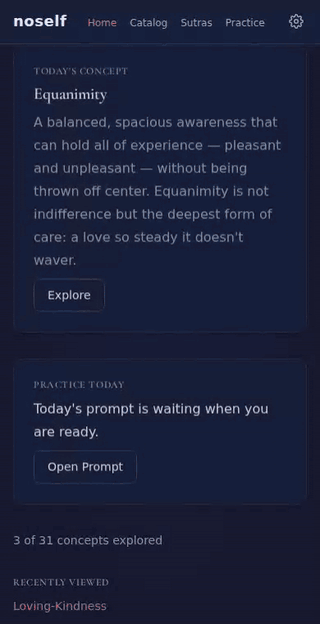
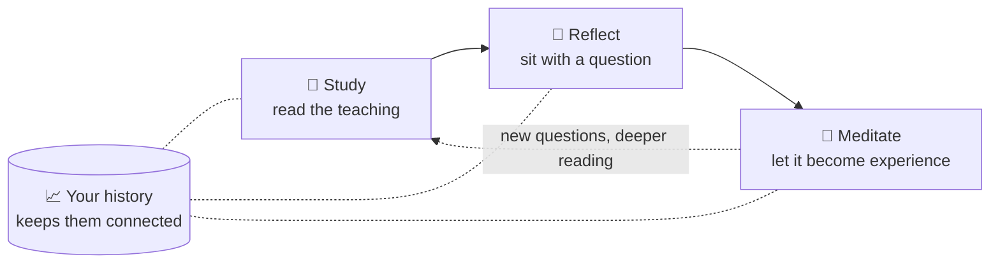
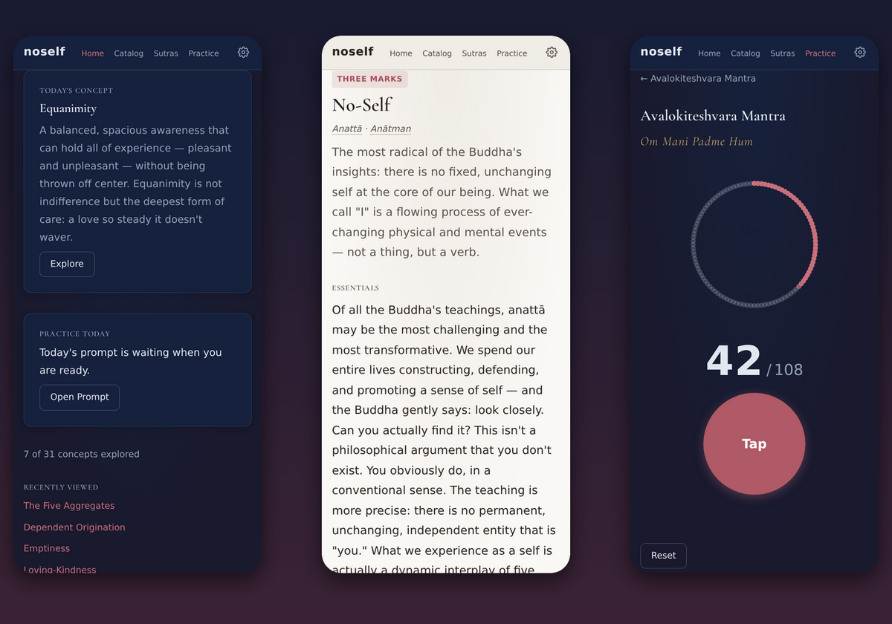
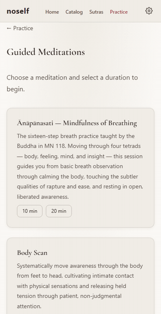
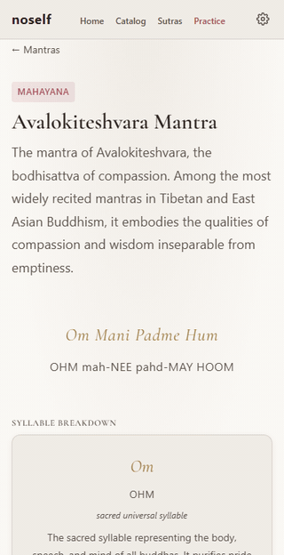
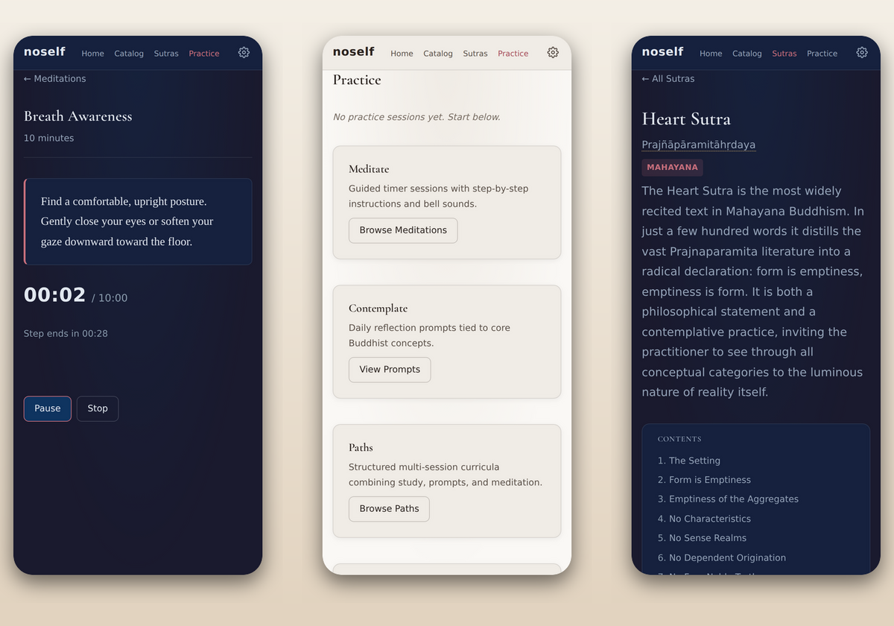
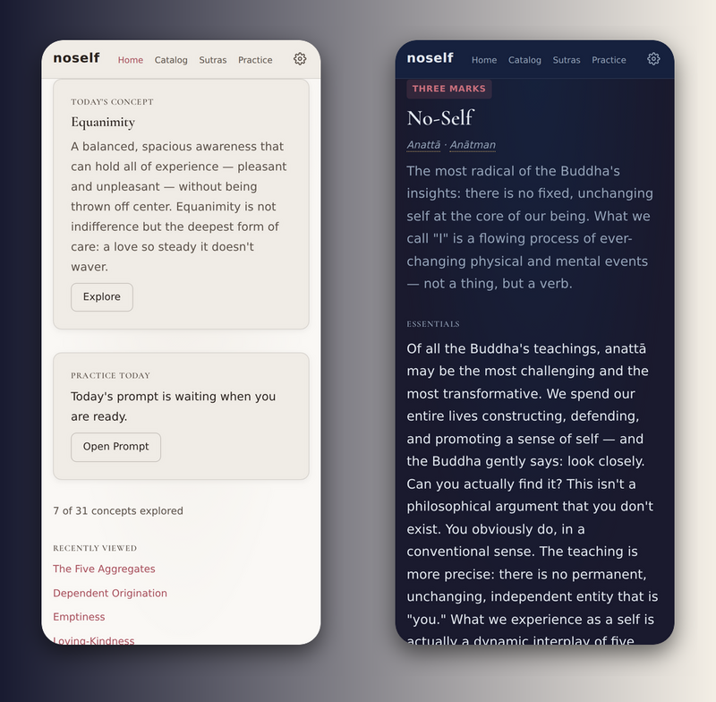

<div align="center">

# noself

<!-- hub-link -->
> Part of [Chris's app hub](https://chrisbrooksbank-hub.netlify.app) - a directory of all my deployed apps.
<!-- /hub-link -->

**A quiet place to study the Dharma, and a nudge to go and practise it with other people.**

A calm, free app for learning the Buddha's teachings, sitting a guided meditation, and building a daily habit. It installs on your phone, works offline and never asks who you are.


[](https://noself.netlify.app)

**[Open noself.netlify.app](https://noself.netlify.app)**

<a href="https://noself.netlify.app"></a>

<sub>Today's teaching, a catalogue of concepts, tappable Pali terms, a guided sit, and a mala.</sub>

</div>

---

## It's late, and you've just read that there is no self

Maybe a friend mentioned it. Maybe you found a book on a charity-shop shelf, or a bad week sent you looking for something that isn't a pill or a productivity system. You read that suffering has a cause, that the cause can be understood, and that the mind can be trained. You read that the "you" at the centre of everything is less solid than it feels.

Then you close the book. You still feel like yourself, which is a bit annoying. And you have no idea what to do next.

**That gap is what noself is for.** It sits between "that's fascinating" and "I tried sitting once and my knee hurt". You read about _anattā_ in the morning, sit with a question about it at lunch, and do a guided meditation on it in the evening. Your history ties the three together.

The tradition calls these the three kinds of wisdom: _sutamaya paññā_ (from study), _cintāmaya paññā_ (from reflection) and _bhāvanāmaya paññā_ (from meditation). Reading alone isn't enough, and neither is sitting without understanding. Each feeds the others.



<p align="center">
  
</p>

## A word before you begin

The Buddhist path has been walked for roughly 2,500 years, and it has changed a great many lives, quietly and for the better. **An app is not what does that.** What does it is practice over time, an ethical life, and, for most people, good friends and a teacher.

So noself is a doorway. It is meant to get you reading, sitting and asking better questions. It does not try to keep you inside. If it works, the best outcome is that you close it and go and sit with other people. [There's a whole section on how](#go-further-this-is-the-important-bit).

## See it in use

<table>
<tr>
<td align="center" width="50%">
<br/>
<sub><b>A guided sit.</b> Each step of the meditation appears when you need it, with a bell at every transition. The timer follows the clock, so locking your phone doesn't stretch your sit.</sub>
</td>
<td align="center" width="50%">
<br/>
<sub><b>A mala in your pocket.</b> Tap once per repetition. Beads fill around the circle, with a bell each quarter mala and a quiet "May all beings benefit" at 108.</sub>
</td>
</tr>
</table>

## What's inside

### 📖 Study: 31 concepts, three depths each

Every teaching is written at three levels, so it grows with you:

- **Brief:** the idea in a sentence or two
- **Essentials:** an accessible introduction
- **Deep:** history, how the traditions differ, and the subtle points

Each concept has sutta quotes and commentary that link it back to practice. Pali and Sanskrit terms are **tappable**, with pronunciation, literal meaning and etymology (e.g. _an_ (not) + _attā_ (self)). A new **Concept of the Day** appears at your local midnight.

<details>
<summary><b>See all 31 concepts</b></summary>

| Category            | Concepts                                                                           |
| ------------------- | ---------------------------------------------------------------------------------- |
| Foundational        | Four Noble Truths · Noble Eightfold Path · Three Jewels · Middle Way · Three Marks |
| Three Marks         | Anicca · Dukkha · Anattā                                                           |
| Mind & Practice     | Sati · Ānāpānasati · Bhāvanā · Samatha · Vipassanā · Five Precepts · Karma         |
| Buddhist Psychology | Five Aggregates · Three Poisons · Dependent Origination · Twelve Links             |
| Brahmavihāras       | Mettā · Karuṇā · Muditā · Upekkhā                                                  |
| Mahāyāna            | Śūnyatā · Buddha-nature · Bodhisattva · Interbeing · Prajñā                        |
| Liberation          | Nirvāṇa · Saṃsāra · Awakening                                                      |

</details>

### 📜 Sutras

Section-by-section study editions of the **Heart Sutra**, **Diamond Sutra**, **Ānāpānasati Sutta** and **Dhammapada**, each with a table of contents and an inline glossary. Pali and Sanskrit primers explain the scripts and sounds, so you can read the originals aloud without feeling like you're defusing a bomb.

### 🧘 Practice

<p align="center">
  
</p>

- **Guided meditations:** Breath Awareness, Ānāpānasati (all 16 contemplations), Body Scan, Mettā, Vipassanā and Open Awareness, at 5 to 30 minutes.
- **Contemplation prompts:** a daily reflection question with guidance, drawn from 28 prompts you can browse by concept and depth. Mark one "Sat with this" once you've spent real time with it.
- **Practice paths:** multi-day curricula (_7-Day Mettā_, _Foundations of Mindfulness_, _Exploring Non-Self_) that combine reading, reflection and meditation.
- **Mantras:** seven mantras, including _Oṃ Maṇi Padme Hūṃ_ and the Vajrasattva hundred-syllable mantra, each with a syllable breakdown and meaning, plus the **108-bead mala counter** shown above.
- **Puja:** the Triratna **Sevenfold Puja**, to study verse by verse or to perform as a guided ritual with timed steps. It's a communal practice, so see [Go further](#go-further-this-is-the-important-bit).
- **History and streaks:** every completed meditation, prompt, path session, puja and mala is logged so you can see your continuity over time.

### 🌗 Made for slow, daily use

<p align="center">
  
</p>

- **Three expertise levels.** _Exploring_ gives you simple introductions. _Deepening_ adds fuller teachings, sutras and mantras. _Immersed_ unlocks everything, including pujas and original texts.
- **Light, dark or auto theme**, adjustable text size, and Cormorant Garamond type chosen for long reading.
- **Gentle reminders.** Optional in-app or push notifications at a time you choose. After a few quiet days they invite you to begin again, without guilt.
- **Offline-first.** Install it to your home screen and all the content is already there. It works on a train, on a hillside, or in a tent at a retreat.

---

## Go further: this is the important bit

An app can teach you words and keep you company on a Tuesday. It can't notice that you're gripping the cushion, answer the question you didn't know you had, or sit beside you while you find out that other people struggle with the same things. Those are the things that change lives, and they happen in a room with people.

**If noself has made you even slightly curious, please do one of these:**

- **Visit a local Buddhist centre.** Nearly all of them run free or donation-based introductory evenings for complete beginners. You don't need to believe anything, own anything or know any Pali. You'll mostly be asked if you'd like tea.
- **Try a day retreat, then a weekend.** A retreat is a few days of structured quiet with a teacher and others who are practising. It's less exotic than it sounds, and it's where many people find that meditation stops being a technique and starts being a way of seeing.
- **Find a teacher or a sangha.** The Buddha called good friends on the path "the whole of the holy life". It's one of the more quotable things he said, and one of the more practical.

A few places to start. These are well-established and welcoming to newcomers. None is affiliated with noself, and there are many more, so look for what's near you:

| If you want…                              | Try                                                                      |
| ----------------------------------------- | ------------------------------------------------------------------------ |
| A centre near you, in the UK and beyond   | [Triratna Buddhist Community centres](https://thebuddhistcentre.com)     |
| A Theravāda monastery, Ajahn Chah lineage | [Amaravati Buddhist Monastery](https://amaravati.org) (Hertfordshire)    |
| Insight meditation retreats               | [Gaia House](https://gaiahouse.org.uk) (Devon)                           |
| Mindfulness in the Thich Nhat Hanh way    | [Plum Village](https://plumvillage.org) (France), with sanghas worldwide |
| A 10-day silent retreat, run on donation  | [Dhamma.org](https://www.dhamma.org) (S. N. Goenka tradition)            |

A kind word of caution: retreats are intense, because quiet shows you what's in your mind. If you have a history of trauma, depression or other mental-health difficulty, talk to the organisers first. Good ones will want that conversation, and will tell you honestly whether a retreat is right for you right now.

### Read the real thing

noself's texts are **study editions**: a way in, not a final word. When something grabs you, go to the source and to the teachers who've given their lives to it:

- [SuttaCentral](https://suttacentral.net): the early discourses, free, in many languages
- [Access to Insight](https://www.accesstoinsight.org): a large library of Theravāda translations and essays
- Teachers whose talks and books are a good next step: **Ajahn Brahm**, **Thich Nhat Hanh**, **Yongey Mingyur Rinpoche**, **Bhikkhu Bodhi**, **Joseph Goldstein**, **Sangharakshita**. Several have talks linked from inside the app, and the links go to the teachers' own channels.

## About the traditions and the texts

noself draws on **Theravāda** (the Pali discourses, ānāpānasati, the brahmavihāras), **Mahāyāna** (the Heart and Diamond sutras, śūnyatā, the bodhisattva ideal), **Tibetan** and **Zen** material, and a **Triratna** liturgy. The traditions disagree with each other in places, and the Deep level of each concept says so rather than smoothing it over. If you find a teaching presented inaccurately, or one tradition's view given as everyone's, please [open an issue](../../issues). Getting this right matters to us more than getting it done.

The Sevenfold Puja is a living devotional practice of the [Triratna Buddhist Community](https://thebuddhistcentre.com). Here it's presented for study and for personal use. It is best learned in company, and Triratna centres are the place to do that.

## Private by design

A practice app should be one of the few places that isn't watching you back.

- **No account. No analytics. No ads.** Your history, preferences and progress live in your browser's `localStorage` and never leave your device.
- **Fonts are bundled** and the app is precached, so using it doesn't call out to other servers. (Video links are plain links to the teachers' own channels, and nothing loads until you tap one.)
- **Push reminders are optional**, and are the one thing that touches a server. If you turn them on, your browser's push address, time zone, reminder time and reminder type are stored so the reminder can be sent. No name, no email, and none of your practice history. Turn them off and they're deleted.

---

## For the curious

### Run it locally

```bash
npm install
npm run dev
```

Open the URL Vite prints, then use the ⚙️ settings panel to pick your expertise level and theme. For everyday use, the quickest way is to open **[noself.netlify.app](https://noself.netlify.app)** on your phone and choose "Add to Home Screen".

| Command            | Description                                           |
| ------------------ | ----------------------------------------------------- |
| `npm run check`    | Typecheck + lint + format check + dead code detection |
| `npm run test:run` | Run the tests once                                    |
| `npm run build`    | Typecheck and build for production                    |
| `npm run deploy`   | Check, test, build and deploy to Netlify              |

To regenerate the animated GIFs above: `npm run build`, start `npm run preview`, then run `node docs/make-gifs.mjs` (needs `ffmpeg` and `npm i --no-save playwright`).

### Tech stack

- **TypeScript** (strict) + **Vite**, with no UI framework: small, fast, hash-routed views
- **YAML content** validated at load time, so new teachings need no code changes
- **Zod** for runtime config validation
- **vite-plugin-pwa** + Workbox for offline support and installability
- **Web Audio API** for the synthesised bell
- **Netlify Functions + Blobs + web-push** for scheduled reminders
- **Vitest** + jsdom, **ESLint 9**, **Prettier**, **Husky**, **Knip**

### Project structure

```
src/
  core/         — views, router, preferences, practice history, reminders
    practice/   — meditation timer, mantra counter, puja, prompts, paths
  content/      — YAML: concepts, sutras, meditations, mantras, pujas,
                  prompts, paths, primers, videos
  config/       — Zod-validated app config
  styles/       — single hand-written stylesheet with light/dark tokens
  utils/        — logger, text formatting, retry/debounce/throttle helpers
  sw.ts         — service worker (precache + push notifications)
netlify/
  functions/    — save/delete push subscriptions, hourly reminder sender
```

### Push reminders (optional)

Push reminders are sent by a scheduled Netlify Function (`netlify/functions/send-daily-reminders.ts`, which runs hourly) and use Netlify Blobs for storage. To enable them, set:

| Variable                | Where            | Purpose                                 |
| ----------------------- | ---------------- | --------------------------------------- |
| `VITE_VAPID_PUBLIC_KEY` | build            | Lets the browser subscribe to push      |
| `VAPID_PUBLIC_KEY`      | Netlify function | Signs push messages                     |
| `VAPID_PRIVATE_KEY`     | Netlify function | Signs push messages                     |
| `VAPID_SUBJECT`         | Netlify function | Contact URI, e.g. `mailto:you@site.org` |

Without them, reminders fall back to in-app banners and local notifications.

## Contributing

The most valuable contributions are **corrections and care**: a mistranslated term, a teaching that's slightly off, a tradition misrepresented. If you're a practitioner or teacher and something reads wrong, please say so.

Teachings live in plain YAML under `src/content/`. To add a concept, copy an existing file in `src/content/concepts/`, add its id to `CONCEPT_IDS` in `src/content/concepts/index.ts`, and run `npm run test:run`. YAML files are picked up automatically, and the loader tests check that every concept is present and complete. When adding content, keep to the tone of what's there: plain, warm, accurate and unhurried. Humour is welcome. Flippancy about the teachings isn't.

## License

[MIT](LICENSE)

---

<p align="center"><em>May all beings be happy. May all beings be free.<br/>And may you find your way to a cushion, in a room, with other people.</em></p>
